<div align="center">


# HSS · Hospital Scheduling System

**Doctor rosters for on-call, ward rotation and Morning / Evening / Night shifts, with leave, on-call and swap requests.**

[](https://hss.adamnajmi.com)


[Live demo](https://hss.adamnajmi.com) · [Features](#features) · [Tech stack](#tech-stack) · [Run it locally](#run-it-locally) · [Deployment](#deployment)

</div>

<br>

<picture>
  <source media="(prefers-color-scheme: dark)" srcset="docs/screenshots/dashboard-admin-dark.webp">
  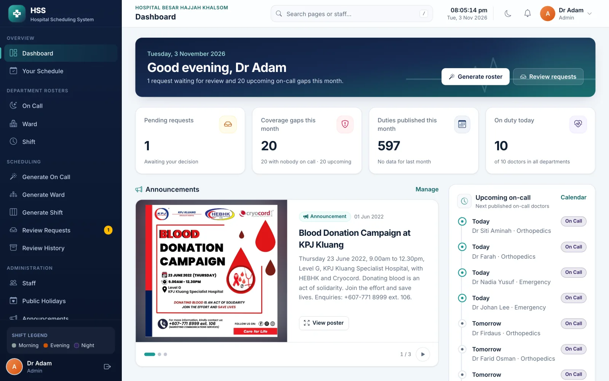
</picture>

## About

I built HSS for **Hospital Besar Hajjah Khalsom** as my final-year project at Universiti Teknologi Malaysia in 2023. The first version used Laravel 10, Jetstream, Bootstrap, FullCalendar 3 and MySQL. In 2026 I rebuilt it on Laravel 12. I kept the shape of the original app and rewrote the parts that did not hold up.

The original code is still on `main` at the tag `v1-fyp`.

> [!TIP]
> On the [live demo](https://hss.adamnajmi.com/login), use the **Demo accounts** buttons on the login page to sign in as an admin, a scheduler or a doctor with one click.

## Features

| | |
| --- | --- |
| **Three roster generators.** On call, ward rotation and shifts, for one department and one month at a time. Each run is a preview with a fairness report and coverage gaps, and nothing is published until I confirm it. | **Calendars.** A department timeline, month and list view built on FullCalendar 6. A scheduler can drag a duty to another day, and a move that double-books a doctor is refused. |
| 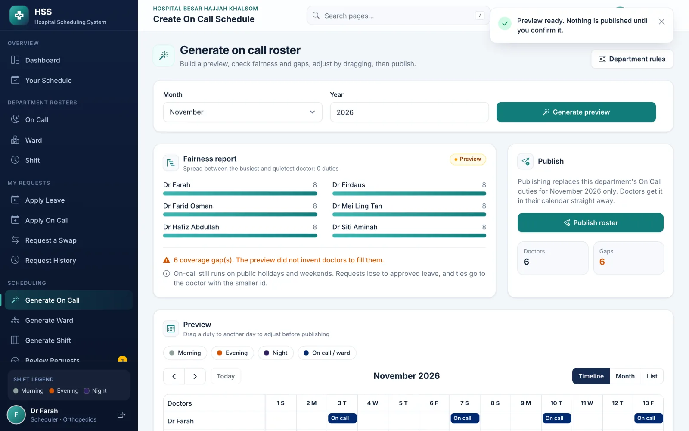 | 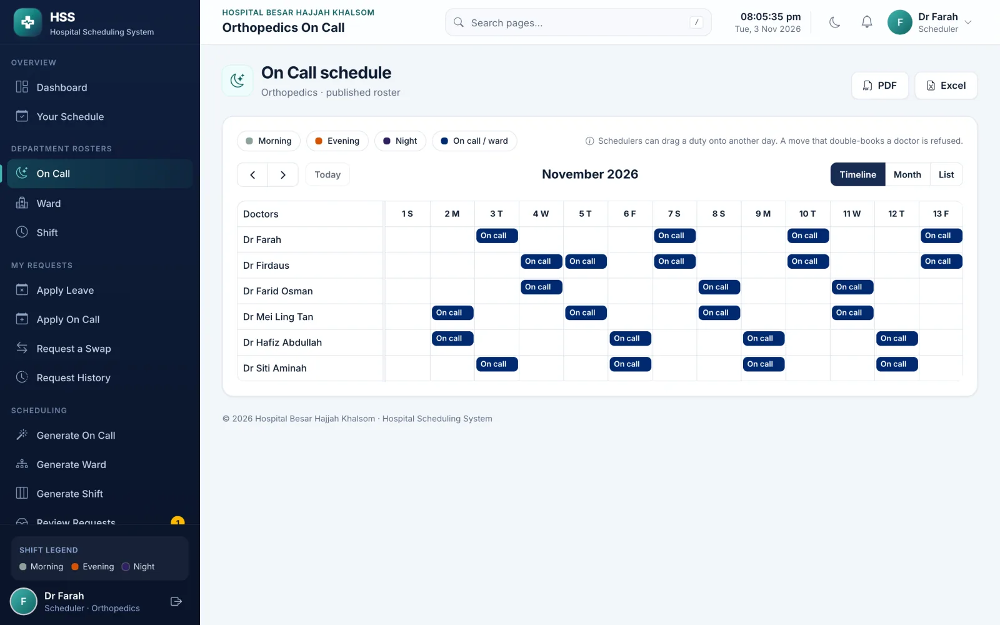 |
| **Requests and review.** Doctors apply for leave or on call, or ask for a swap. A scheduler approves, or rejects with a reason, and every decision lands in the history. | **Doctor dashboard.** Each doctor sees their next duty, this month's coverage and the hospital announcements. |
| 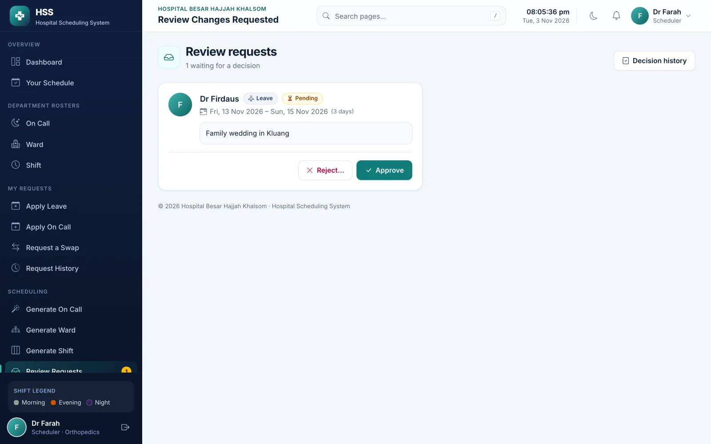 | 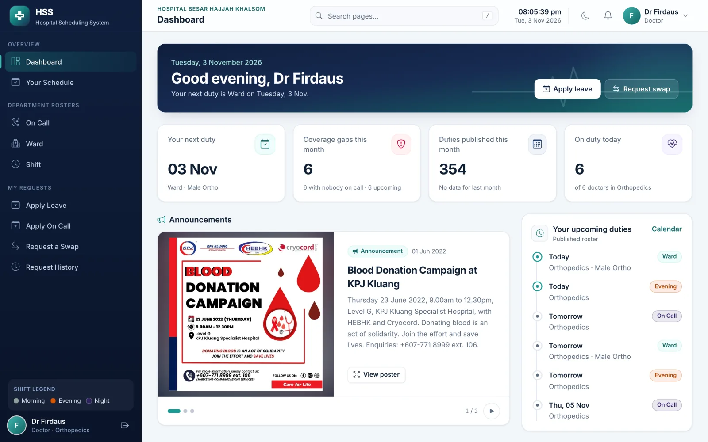 |
| **Your schedule.** A personal calendar of every published duty across on call, wards and shifts. | **Calendar subscription.** A private feed link for Google Calendar, Apple Calendar or Outlook that updates on its own and can be reset, plus a one-off `.ics` download. |
| 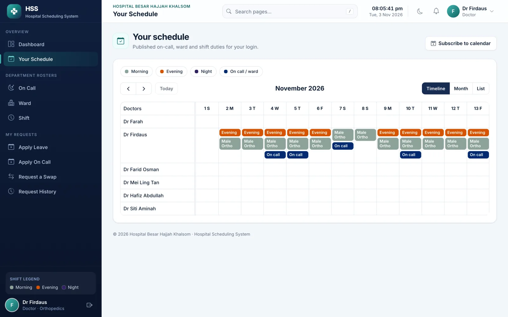 | 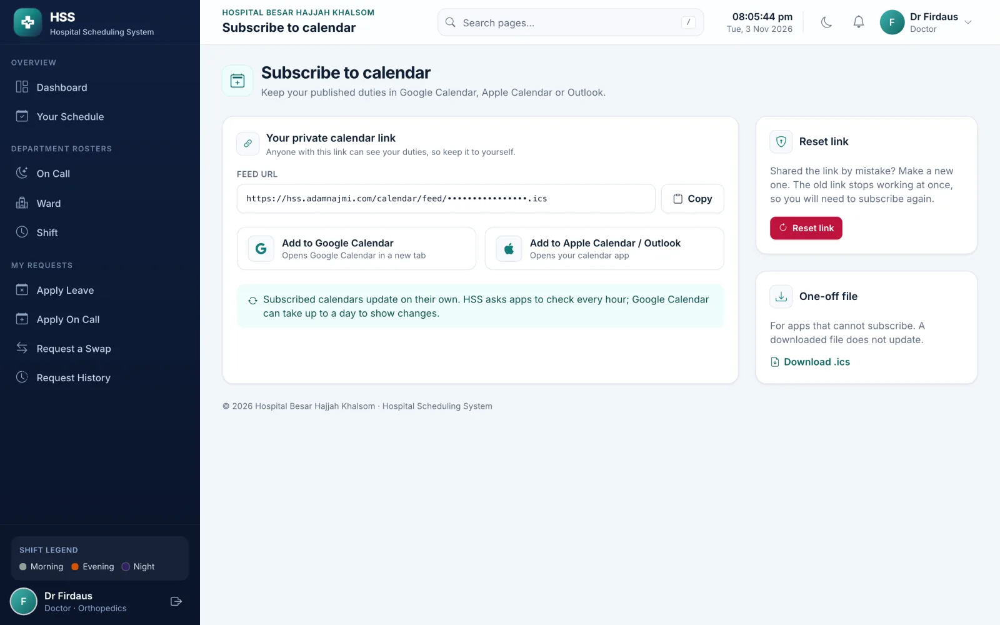 |
| **Public landing page and login.** The landing page shows the latest announcements, and the login page has the demo account buttons. | **Mobile and dark mode.** Every screen works on a phone, and there is a light and a dark theme. |
| 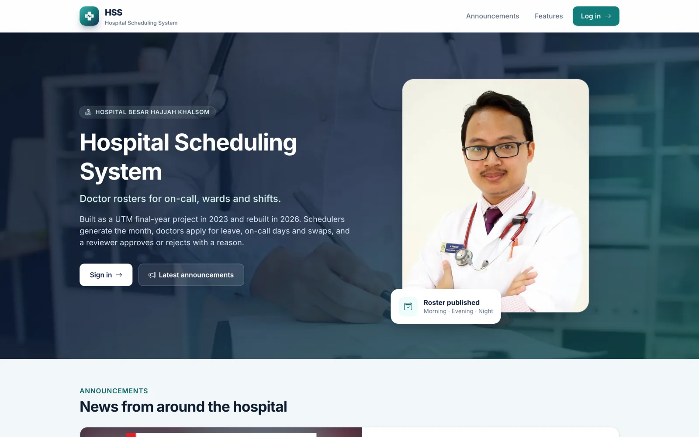 | 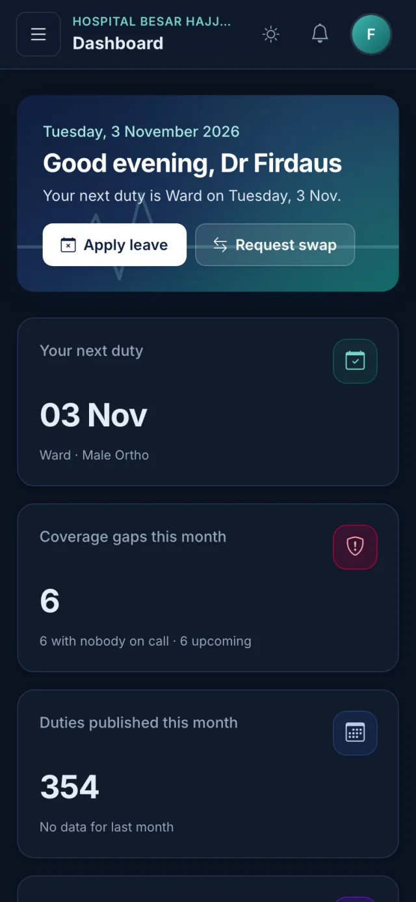 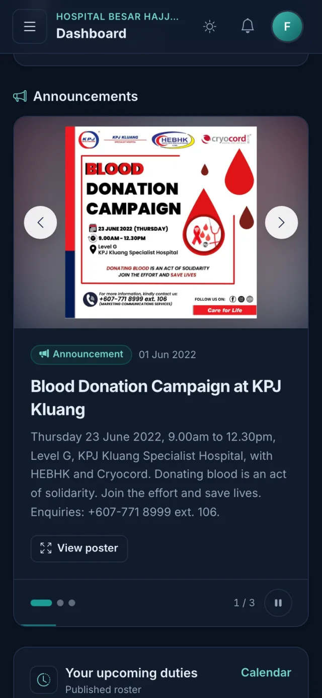 |

<details>
<summary><b>More screens and smaller features</b></summary>

<br>

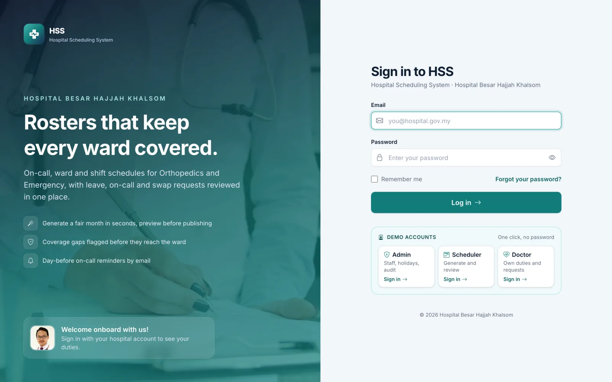

- **Announcements.** Admins post notices with a poster image, an optional link and an expiry date. They show as a carousel on the dashboard and the landing page.
- **Exports.** Department rosters export to PDF and Excel.
- **Notifications.** Doctors get a mail and in-app notification when a request is decided, plus a reminder the day before an on-call duty.
- **Department rules.** Each department sets doctors per on-call day, the monthly on-call cap, the ward block length, weekend shifts and rest after a night shift. This is a Livewire Volt screen.
- **Administration.** Staff management, public holidays (national, plus the state each department follows) and an audit log.

</details>

## Demo accounts

Every demo account uses the password `password`.

| Name | Login | Role |
| --- | --- | --- |
| Dr Adam | `admin@hss.test` | Admin, all departments |
| Dr Farah | `scheduler@hss.test` | Scheduler, Orthopedics |
| Dr Firdaus | `doctor@hss.test` | Doctor, Orthopedics |

Emergency has its own scheduler at `emergency.scheduler@hss.test`.

## Tech stack

| Layer | What I used |
| --- | --- |
| Backend | Laravel 12, Fortify, Livewire 3 with one Volt screen |
| Frontend | Blade, Alpine, Tailwind CSS 4, Vite 7, FullCalendar 6, Bootstrap Icons |
| Database | PostgreSQL (Neon in production). The MySQL connection is still in `config/database.php`. |
| Exports | `barryvdh/laravel-dompdf` for PDF and `maatwebsite/excel` for Excel |
| Testing | Pest, Larastan, Pint and Playwright, run in GitHub Actions |
| Hosting | Vercel with the `vercel-php` runtime, Vercel Blob for announcement images and a daily Vercel Cron job |

## What I kept and what I changed

<details>
<summary><b>What I kept from the 2023 version</b></summary>

- The name, the "Dr {name}" labels, and the three roles: admin, scheduler and doctor (`regular`).
- Departments stay separate. Orthopedics and Emergency do not share a roster.
- The three generators and their rules: two doctors on call (the cap I intended was 6, and it is now configurable), a 14-day ward round-robin, and balanced Morning / Evening / Night duties.
- The request flow: apply, review, approve or reject with a reason, then history.
- The calendar is still the centre of the screen.
- The shift colours: Morning `#8da399`, Evening `#d65302`, Night `#311F62`.
- Bootstrap icons, a confirm dialog before a destructive step, and `login_bg.jpg` with `dr.jpg` on the login page.

</details>

<details>
<summary><b>What I changed in the 2026 rebuild</b></summary>

- I moved to Laravel 12, Livewire 3, Tailwind 4, Vite and FullCalendar 6.
- PostgreSQL is now the default database.
- I replaced three stringly-typed assignment tables with one `schedule_assignments` table. Requests share one table, and doctors point at a `departments` row.
- Generators run for one department and one month, inside a transaction, with bulk inserts. They preview first and publish only that month. They no longer `truncate()` every department.
- Public registration cannot choose a role. It is forced to doctor, and only for a department that already exists.
- The timezone is `Asia/Kuala_Lumpur`, and duties are stored as dates, not UTC datetimes.
- Status values are `pending`, `approved` and `rejected`. The 2023 app stored `Pending`, `Yes` and `No`.
- I removed committed logs, sessions, cache files and compiled views from the tree and ignored them. I did not rewrite the history of `main` or the `v1-fyp` tag.

I left out live updates on purpose, so Laravel Reverb is not wired up.

</details>

## How the generators work

All three read the same context: the doctors in the department (everyone except admins, ordered by id), approved leave expanded across the whole date range, approved on-call requests, and public holidays for `National` plus the department's state. A run is stored as `preview` until someone publishes it, and re-running a preview replaces the previous preview for that month.

<details>
<summary><b>On call</b></summary>

For each day of the month, approved on-call requests are placed first, and leave wins over a request. Each doctor is capped at `monthly_on_call_cap` (default 6). Empty slots go to the doctor with the fewest duties so far, and the lower id breaks a tie. My 2023 code counted the cap per day, and on a day that already had a request it inserted a stale `$doctorId`. Hospitals stay covered on weekends and public holidays, and gaps are reported instead of inventing doctors. Two doctors a day is the default and can be changed per department.

</details>

<details>
<summary><b>Ward rotation</b></summary>

Wards are ordered by id, and each doctor walks the month. A day of leave is skipped. Otherwise the doctor takes the next ward for `ward_block_days` (default 14), clamped to the end of the month, and leave days inside the block are left empty. The next block starts the day after the previous one ends. My 2023 loop set the cursor to the end date itself, so every block overlapped by one day. The ward index keeps moving from doctor to doctor, which is the original round-robin.

</details>

<details>
<summary><b>Shifts</b></summary>

Weekdays only, unless the department turns weekends on. Public holidays and leave are skipped. Each day, the free doctors (fewest duties first) get the shift that nobody has yet that day, then the shift the department has used least this month. Morning wins a tie, then Evening, then Night. My 2023 loop walked doctors first and days second, so the whole department often landed on the same shift. Rest after a night shift is off by default, as it was in 2023, and can be turned on in the rules screen.

</details>

## Data model

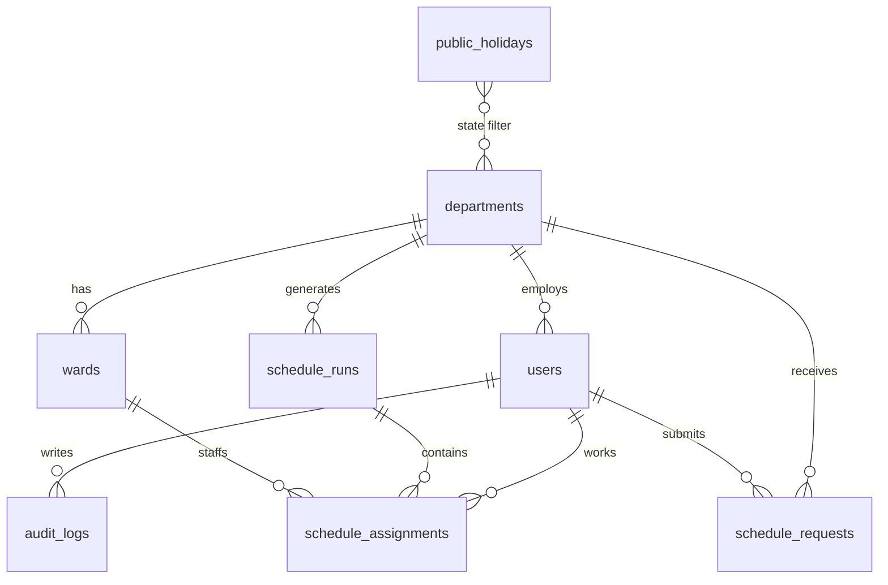

`schedule_assignments` is unique on `(schedule_run_id, user_id, date, type)`, so a doctor cannot hold two duties of the same kind on the same day inside one run. Publishing deletes the previous published rows for that department, type and month only.

## Run it locally

You need PHP 8.3, Composer, Node 22 and PostgreSQL 16.

```bash
composer install
cp .env.example .env
php artisan key:generate
# create the database named in .env (hss / hss / secret)
php artisan migrate --seed
npm install
npm run build
php artisan serve
```

<details>
<summary><b>Using Laravel Sail instead</b></summary>

Mail in `.env.example` points at Mailpit (`127.0.0.1:1025`). [Laravel Sail](https://laravel.com/docs/sail) includes that service:

```bash
./vendor/bin/sail up -d
./vendor/bin/sail artisan migrate --seed
./vendor/bin/sail npm run build
```

Sail runs PHP 8.3, PostgreSQL 16 and Mailpit. Mailpit's inbox is on port 8025.

</details>

The department timeline uses FullCalendar's premium resource-timeline plugin. Set `VITE_FULLCALENDAR_LICENSE` to your key. Without it, the app falls back to FullCalendar's non-commercial Creative Commons key.

## Testing

The feature tests use SQLite in memory, so they do not need PostgreSQL:

```bash
php artisan test
vendor/bin/pint --test
vendor/bin/phpstan analyse
npm run build
npx playwright test
```

Playwright expects the app on `http://127.0.0.1:8001` (override it with `PLAYWRIGHT_BASE_URL`) with the demo seeder already applied. If `php artisan serve --port=8001` is already running, the config reuses it; otherwise it starts one on that host and port. Its screenshots go to `test-results/screenshots`, or wherever `PLAYWRIGHT_SHOTS` points. The README images in `docs/screenshots` are kept separately.

GitHub Actions runs Pint, Larastan, Pest, the Vite build and Playwright on every push.

## Deployment

I host HSS on **Vercel** with a **Neon** PostgreSQL database.

- `vercel.json` sends every request to `api/index.php` on the `vercel-php` runtime in the `sin1` region, and serves `build/`, `images/` and `css/` as static files.
- Announcement images are stored in Vercel Blob through `app/Filesystem/VercelBlobAdapter.php`.
- Vercel has no long-running scheduler, so one daily Vercel Cron job calls `/api/cron/daily` at 08:00 Malaysia time. It sends on-call reminders, expires announcements and prunes old data. The endpoint needs the cron secret as a bearer token.
- A Sentry DSN can be set as `SENTRY_LARAVEL_DSN`. The package is not installed yet; add `sentry/sentry-laravel` to export the events.

## Roadmap

- Live calendar updates with Laravel Reverb
- Error reporting with Sentry

## Acknowledgements

- Doctor portrait (`public/images/doctor-card-*.webp`, `doctor-face-192.webp`, `dr.jpg`): a photo I supplied for this project.
- Login background (`public/images/login_bg.jpg`): [Vitaly Gariev on Unsplash](https://unsplash.com/photos/doctor-writing-on-clipboard-in-office-xDNwySMfR5I), Unsplash License.
- Thanks to Universiti Teknologi Malaysia, where HSS started as my final-year project.
