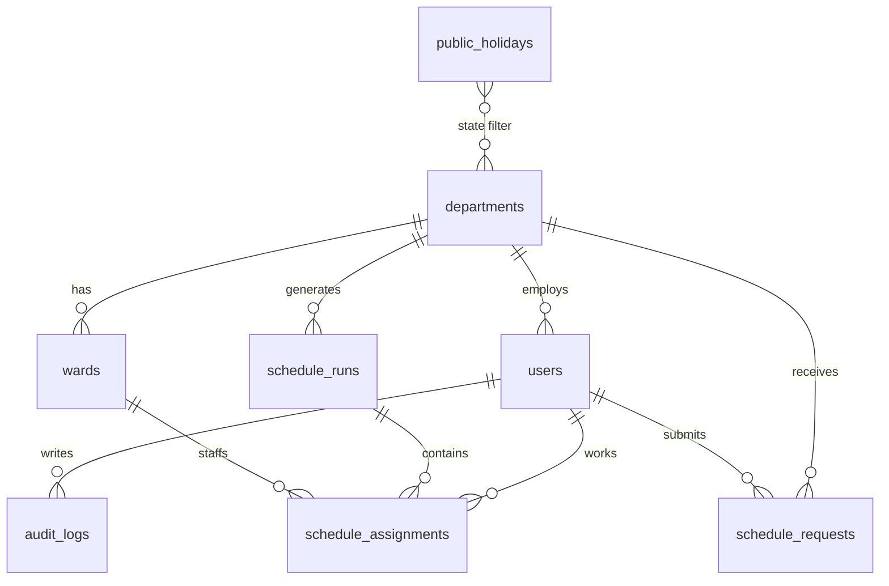
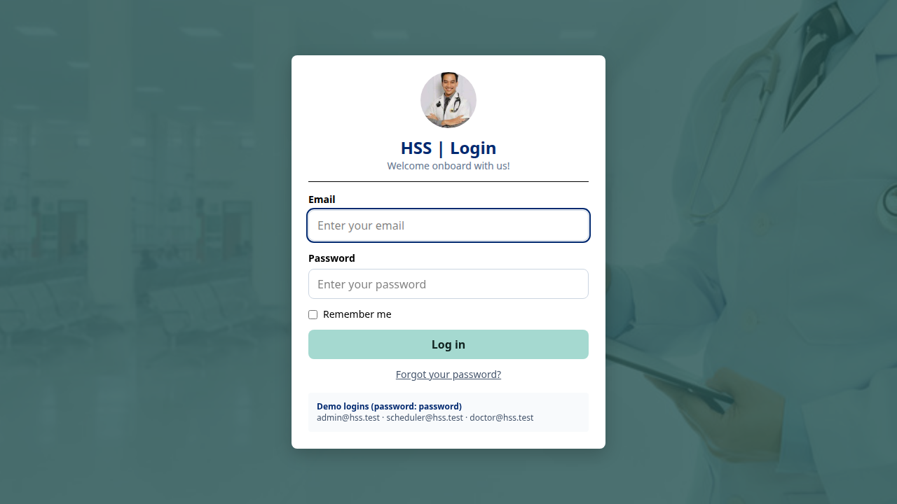
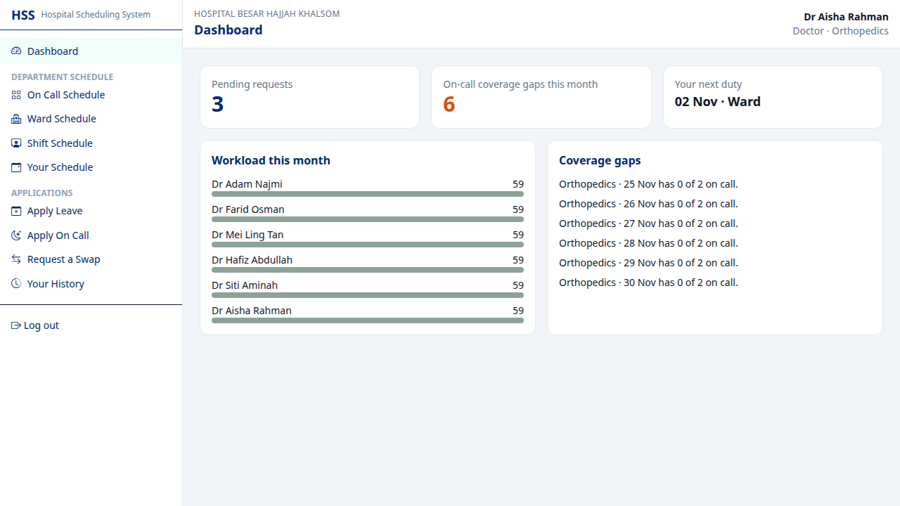
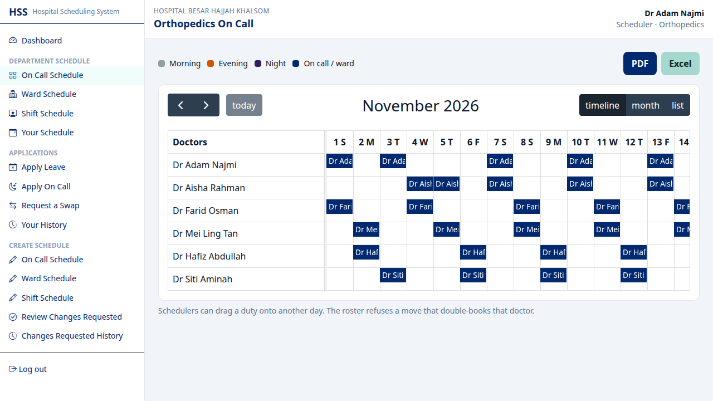
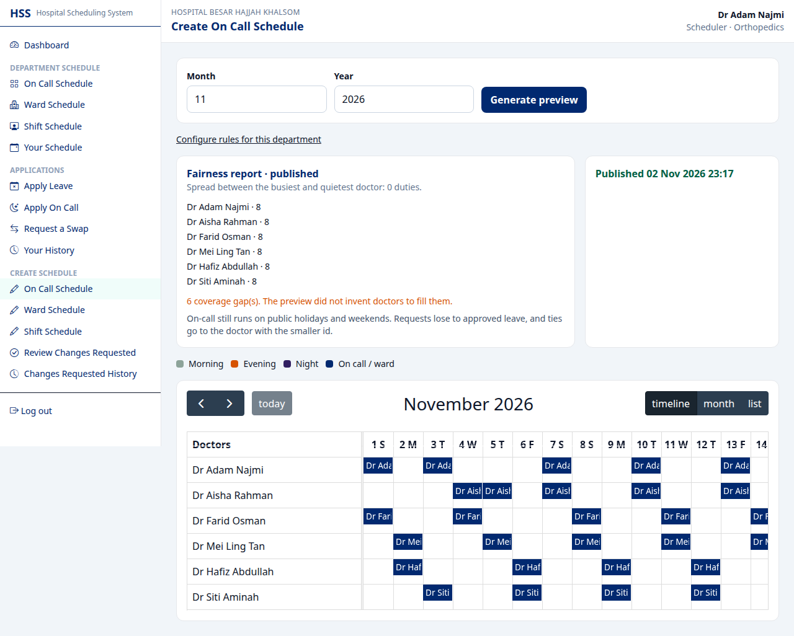
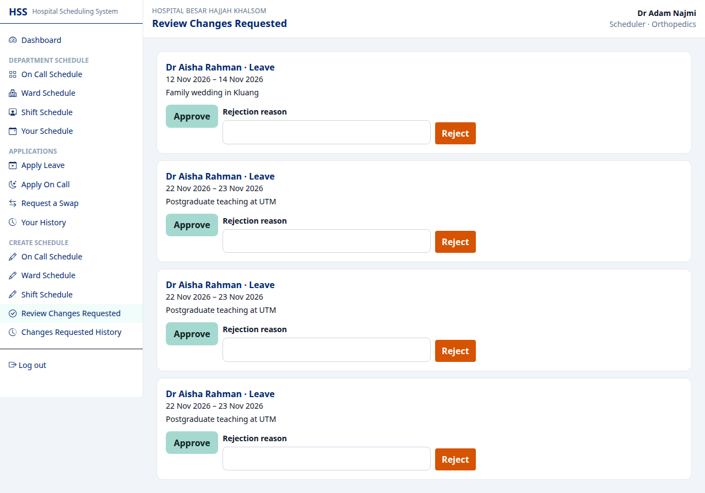
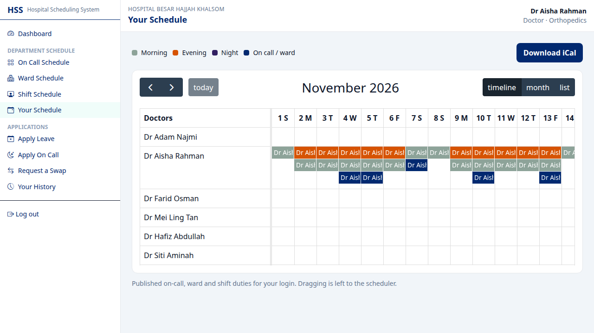

# HSS | Hospital Scheduling System

A doctor rostering app for **Hospital Besar Hajjah Khalsom**: on-call, ward rotation, and Morning / Evening / Night shifts, plus leave and on-call requests.

This started as Adam Najmi's Universiti Teknologi Malaysia final-year project in 2023 (Laravel 10, Jetstream, Bootstrap, FullCalendar 3, MySQL). The 2026 revamp keeps that shape and moves it onto Laravel 12.

The original tree is still on `main` at the tag `v1-fyp`.

## What stayed

- The name, the "Dr {name}" labels, and the three roles: admin, scheduler, doctor (`regular`).
- Departments stay separate. Orthopedics and Emergency do not share a roster.
- The three generators and their rules: two doctors on call (cap intended at 6, now configurable), a 14-day ward round-robin, and balanced Morning / Evening / Night duties.
- Apply, then review, then approve or reject with a reason, then history.
- The calendar is still the centre of the screen. A scheduler can drag a duty to another day.
- Shift colours: Morning `#8da399`, Evening `#d65302`, Night `#311F62`.
- The light sidebar, Bootstrap icons, a confirm dialog before a destructive step, and `login_bg.jpg` with `dr.jpg` on the login card.

## What changed

- Laravel 12, Livewire 3 with one Volt screen (department rules), Tailwind 4, Vite, FullCalendar 6.
- PostgreSQL is the default. The MySQL connection is still in `config/database.php`.
- One `schedule_assignments` table instead of three stringly-typed assignment tables. Requests share one table. Doctors point at a `departments` row.
- Generators run for one department and one month, inside a transaction, with bulk inserts. They preview first and publish only that month. They no longer `truncate()` every department.
- Public registration cannot choose a role. It is forced to doctor, and only for a department that already exists.
- Timezone is `Asia/Kuala_Lumpur`. Duties are stored as dates, not UTC datetimes.
- Status values are `pending`, `approved` and `rejected`. The 2023 app stored `Pending`, `Yes` and `No`.

Laravel Reverb is not wired up. Live updates were left out on purpose.

Committed logs, sessions, cache files and compiled views were removed from the tree and ignored. Rewriting old history is a separate decision; this branch does not rewrite `main` or the `v1-fyp` tag.

## Roles

| Login | Password | Role |
| --- | --- | --- |
| admin@hss.test | password | Admin, all departments |
| scheduler@hss.test | password | Scheduler, Orthopedics (Dr Adam Najmi) |
| doctor@hss.test | password | Doctor, Orthopedics (Dr Aisha Rahman) |

Emergency has its own scheduler at `emergency.scheduler@hss.test`.

## Setup

PHP 8.3, Composer, Node 22, and PostgreSQL 16.

```bash
composer install
cp .env.example .env
php artisan key:generate
# create the database named in .env (hss / hss / secret)
php artisan migrate --seed
npm install
npm run build
php artisan serve
```

Mail in `.env.example` points at Mailpit (`127.0.0.1:1025`). With [Laravel Sail](https://laravel.com/docs/sail) that service is included:

```bash
./vendor/bin/sail up -d
./vendor/bin/sail artisan migrate --seed
./vendor/bin/sail npm run build
```

Sail runs PHP 8.3, PostgreSQL 16 and Mailpit. Mailpit's inbox is on port 8025.

Tests use SQLite in memory and do not need PostgreSQL:

```bash
php artisan test
vendor/bin/pint --test
vendor/bin/phpstan analyse
npm run build
npx playwright test
```

Playwright expects the app on `http://127.0.0.1:8001` (override with `PLAYWRIGHT_BASE_URL`) with the demo seeder already applied. `php artisan serve --port=8001` can already be running; the config reuses it, otherwise it starts one on that host and port. Set `PLAYWRIGHT_SHOTS` to save the screenshots somewhere other than `docs/screenshots`.

A Sentry DSN can be set as `SENTRY_LARAVEL_DSN`. The package is not installed. Add `sentry/sentry-laravel` when you want the events exported.

## Data model



`schedule_assignments` is unique on `(schedule_run_id, user_id, date, type)`, so a doctor cannot hold two duties of the same kind on the same day inside one run. Publishing deletes the previous published rows for that department, type and month only.

## The three generators

All three read the same context: doctors in the department (everyone except admins, ordered by id), approved leave expanded across the whole date range, approved on-call requests, and public holidays for `National` plus the department's state. A run is stored as `preview` until someone publishes it. Re-running a preview replaces the previous preview for that month.

**On call.** For each day of the month, approved on-call requests are placed first. Leave wins over a request. Each doctor is capped at `monthly_on_call_cap` (default 6). Empty slots are filled by the doctor with the fewest duties so far, and the lower id breaks a tie. The 2023 code counted the cap per day, and on a day that already had a request it inserted a stale `$doctorId`. Hospitals stay covered on weekends and public holidays; gaps are reported instead of inventing doctors. Two doctors a day is the default and can be changed per department.

**Ward rotation.** Wards are ordered by id. Each doctor walks the month. A day of leave is skipped. Otherwise the doctor takes the next ward for `ward_block_days` (default 14), clamped to the end of the month, and leave days inside the block are left empty. The next block starts the day after the previous block ends. The 2023 loop set the cursor to the end date itself, so every block overlapped by one day. The ward index keeps moving from doctor to doctor, which is the original round-robin.

**Shifts.** Weekdays only, unless the department turns weekends on. Public holidays and leave are skipped. Each day, the free doctors (fewest duties first) are given the shift that nobody has yet today, then the shift the department has used least this month. Morning wins a tie, then Evening, then Night. The 2023 loop walked doctors first and days second, so the whole department often landed on the same shift. "Rest after a night shift" is off by default, matching 2023, and can be turned on in the rules screen.

## Screens













The department calendar uses FullCalendar's resource timeline. That plugin is premium: without `VITE_FULLCALENDAR_LICENSE` the view still renders and FullCalendar prints a license reminder in the console.
